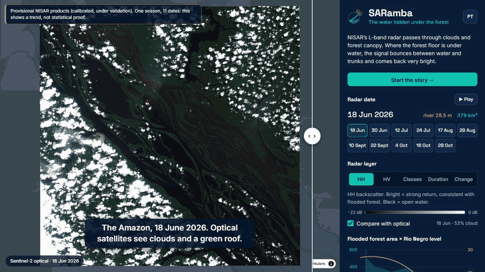

# SARamba — the water hidden under the forest

A web app that uses the L-band radar of **NISAR** (NASA-ISRO) to show the water hidden under the Amazon forest canopy, and how it recedes from the flood season to the dry season, something optical satellites miss because of clouds and tree cover.

Built for the **NASA Space Apps Challenge 2026**, challenge *“Dancing with the SARs”* (São Paulo local event).

**Live demo:** https://richprograming.github.io/saramba/



## The problem

Every year the Rio Negro rises about 10 m and floods the forest of the Anavilhanas archipelago (*igapó*). This flooded forest feeds fish, stores carbon and sets the calendar of river communities. Yet it is very hard to map:

- during high water the region is under cloud most of the time, so optical images are often useless;
- even on a clear day, an optical image shows a green canopy whether the ground below is dry or under water.

L-band radar passes through clouds and through the canopy. Where the forest floor is flooded, the signal bounces between the water surface and the trunks (double bounce) and comes back very bright in HH. Open water reflects the signal away and looks black.

## What the app shows

- **Optical × radar slider.** Sentinel-2 and NISAR over the same place on the same day (18 Jun 2026). The optical image is 53% cloud or cloud shadow inside the window.
- **Timeline.** Eleven NISAR passes from the same orbit, one every 12 days, from high water to low water.
- **Classes.** Open water, flooded forest, and land not flooded on that date.
- **Flood duration map.** On how many of the eleven dates each pixel was classified as flooded forest.
- **Change map.** What was classified as flooded forest in June and no longer is at the end of October.
- **Chart.** Flooded forest area (km²), with an uncertainty band, against the Rio Negro level at Manaus (m).
- **Click a point.** The HH signal of that place across the eleven dates, with the two thresholds.
- **Story mode.** Four cards that walk through the idea. English and Portuguese.

The app only reads small pre-computed files (PNG, JSON and one 1 MB binary, about 24 MB in total) and works offline; without internet only the faint OpenStreetMap background disappears.

## Results (50 × 50 km window over Anavilhanas)

| NISAR date | Rio Negro level at Manaus | Flooded forest | Same, threshold ± 0.5 dB | Open water |
|---|---|---|---|---|
| 18 Jun 2026 | 28.47 m | 379.2 km² | 279–534 km² | 730.9 km² |
| 30 Jun 2026 | 28.50 m | 350.6 km² | 251–455 km² | 732.3 km² |
| 12 Jul 2026 | 28.26 m | 334.6 km² | 234–434 km² | 731.2 km² |
| 24 Jul 2026 | 27.80 m | 315.8 km² | 214–409 km² | 727.1 km² |
| 17 Aug 2026 | 25.94 m | 334.5 km² | 249–447 km² | 705.6 km² |
| 29 Aug 2026 | 24.44 m | 294.5 km² | 214–395 km² | 696.4 km² |
| 10 Sep 2026 | 22.60 m | 246.1 km² | 160–403 km² | 679.7 km² |
| 22 Sep 2026 | 20.35 m | 92.4 km² | 47–190 km² | 676.1 km² |
| 4 Oct 2026 | 18.29 m | 51.2 km² | 24–132 km² | 673.6 km² |
| 16 Oct 2026 | 17.36 m | 41.8 km² | 20–114 km² | 677.7 km² |
| 28 Oct 2026 | 16.49 m | 29.6 km² | 14–66 km² | 679.1 km² |

- Between the first and the last date, 360.1 km² changed from “flooded forest” to “not flooded”.
- 566.6 km² were classified as flooded forest on at least one date, and 209.8 km² on six or more of the eleven.
- Across the eleven dates, flooded area and river level have a Pearson correlation of 0.97. Both series fall through a single dry season, so a high value is expected. It is consistent with the flood receding under the canopy; it is not proof.
- The series is not strictly monotonic: 17 Aug is higher than 24 Jul. We did not investigate the cause.

See [Limitations](#limitations) before quoting these numbers.

## Method

1. **Scene selection** (`scripts/buscar_nisar.py`). Searches NISAR GCOV scenes at ASF and groups them by orbit. Only scenes with the same path, frame and direction are compared: path 68, frame 90, descending. All eleven passes between 18 Jun and 28 Oct 2026 are used. Five recorded HH+HV and six recorded HH only; the classification uses HH, so both kinds enter.
2. **Crop.** A ~50 × 50 km window (bbox in `config.yaml`) is read from `/science/LSAR/GCOV/grids/frequencyA/HHHH` (and `HVHV` where it exists): gamma0, terrain-corrected, UTM 20S, 20 m.
3. **Multilook and speckle filter.** 2 × 2 averaging in power (40 m pixels), then a 5 × 5 Lee filter.
4. **dB.** `10 · log10(power)`, with zeros and invalid samples masked.
5. **Classification from HH**, with thresholds calibrated once on the histogram of all dates together (the same number of pixels from each date), so every date uses the same rule:
   - open water: HH ≤ −11.37 dB (two-class Otsu);
   - flooded forest: HH ≥ −3.65 dB. This is the mode of the non-flooded forest peak (−4.84 dB) plus two standard deviations (0.60 dB) measured on the left side of the peak, which is not contaminated by flooded forest;
   - everything else: not flooded on that date.
6. **Uncertainty band.** The flooded-forest area is recomputed with the threshold moved by ± 0.5 dB.
7. **Area, change and duration.** km² per class and date; a transition map between the first and the last date; and a count of the dates on which each pixel was classified as flooded forest.
8. **Point series.** HH averaged to 160 m cells for every date, stored as one byte per cell, for the click-a-point chart.
9. **River level** (`pipeline/cota.py`). Daily mean of the ANA telemetry for station 14990000 (Manaus), and the correlation with the flooded area.
10. **Optical image** (`pipeline/optico.py`). Sentinel-2 L2A true colour from the public Earth Search STAC, resampled to the radar grid. Cloud percentage from the SCL band.

The thresholds actually used are saved in `app/public/data/stats.json`. The real HDF5 paths found in the product are documented in [`docs/gcov_estrutura.md`](docs/gcov_estrutura.md).

A first attempt at calibration with a three-class Otsu threshold was discarded: it placed the flooded-forest threshold below the peak of the non-flooded forest and labelled almost all forest as flooded.

## Limitations

- **Provisional data.** The NISAR GCOV products used are provisional (calibrated, still under validation).
- **One season.** Eleven dates of a single dry season show a trend, not statistical proof.
- **No field validation.** Thresholds come from the image histogram only. There are no reference polygons or ground truth.
- **The area is sensitive to the threshold.** The flooded-forest threshold sits about 1.2 dB above the peak of the non-flooded forest. Moving it by ± 0.5 dB changes the June area from 279 to 534 km². The direction of the trend does not change.
- **HH thresholds only.** Other bright targets (urban areas, some slopes, wet soil) can be labelled as flooded forest. Isolated bright pixels over upland forest are speckle that the filter did not remove.
- **“Not flooded” is not “upland”.** That class includes island forest that is flooded at other times of the year.
- **The duration map counts dates, not days.** Passes are 12 days apart, with one 24-day gap between 24 Jul and 17 Aug.
- **River level is measured at Manaus**, downstream of the archipelago, and is raw telemetry without consistency checks.
- **Cloud percentage** counts SCL classes 3, 8, 9 and 10; thin cloud can be missed.

## Run it yourself

### App

```bash
cd app
npm install
npm run dev        # development
npm run build      # production build in app/dist
npm run preview    # serve the build locally
```

The processed data is already in `app/public/data/`, so the app runs without the pipeline.

### Pipeline

Requires Python 3.11+ and a free [NASA Earthdata](https://urs.earthdata.nasa.gov) account (only the download needs a login).

```bash
pip install -r requirements.txt

python scripts/buscar_nisar.py                 # 1. list scenes per orbit -> nisar_cenas.csv

export EARTHDATA_TOKEN="your token"            # PowerShell: $env:EARTHDATA_TOKEN="your token"
python scripts/inspecionar_gcov.py --baixar    # 2. download the 11 scenes (~18 GB) to data/

python pipeline/processar.py                   # 3. radar PNGs, classes, change, duration, stats.json
python pipeline/optico.py --data 2026-06-18    # 4. Sentinel-2 image on the same grid
python pipeline/cota.py                        # 5. river level and correlation
```

Region, orbit, dates, window and starting thresholds are in [`config.yaml`](config.yaml). Code comments and script messages are in Portuguese.

## Repository layout

```
config.yaml          region, orbit, dates, bbox, starting thresholds
scripts/             scene search, download, inspection, demo recording
pipeline/            processing: radar, optical, river level
app/                 Vite + React + TypeScript + MapLibre GL + Recharts
  public/data/       pipeline outputs read by the app
docs/                HDF5 structure notes and submission material
brand/               logos
```

## Data and credits

- **NASA-ISRO NISAR** L2 GCOV (provisional), via the Alaska Satellite Facility DAAC. Scenes used:
  - `NISAR_L2_PR_GCOV_023_068_D_090_2005_DHDH_A_20260618T222452_20260618T222527_P05023_N_F_J_001`
  - `NISAR_L2_PR_GCOV_024_068_D_090_2005_SHSH_A_20260630T222452_20260630T222526_P05023_N_F_J_001`
  - `NISAR_L2_PR_GCOV_025_068_D_090_2005_DHDH_A_20260712T222451_20260712T222525_P05023_N_F_J_001`
  - `NISAR_L2_PR_GCOV_026_068_D_090_2005_SHSH_A_20260724T222450_20260724T222525_P05023_N_F_J_001`
  - `NISAR_L2_PR_GCOV_028_068_D_090_2005_SHSH_A_20260817T222449_20260817T222523_P05023_N_F_J_001`
  - `NISAR_L2_PR_GCOV_029_068_D_090_2005_DHDH_A_20260829T222449_20260829T222523_P05023_N_F_J_001`
  - `NISAR_L2_PR_GCOV_030_068_D_090_2005_SHSH_A_20260910T222449_20260910T222523_P05023_N_F_J_001`
  - `NISAR_L2_PR_GCOV_031_068_D_090_2005_DHDH_A_20260922T222449_20260922T222523_P05023_N_F_J_001`
  - `NISAR_L2_PR_GCOV_032_068_D_090_2005_SHSH_A_20261004T222449_20261004T222523_P05023_N_F_J_001`
  - `NISAR_L2_PR_GCOV_033_068_D_090_2005_DHDH_A_20261016T222449_20261016T222523_P05023_N_F_J_001`
  - `NISAR_L2_PR_GCOV_034_068_D_090_2005_SHSH_A_20261028T222449_20261028T222524_P05036_N_F_J_001`
- **ESA Copernicus Sentinel-2** L2A, via Earth Search (Element 84) on AWS: `S2C_20MQB_20260618_0_L2A`, `S2C_20MQC_20260618_0_L2A`.
- **River level:** ANA, Agência Nacional de Águas e Saneamento Básico, telemetry service, station 14990000 (Manaus).
- **Base map:** © OpenStreetMap contributors.
- **Libraries:** asf_search, h5py, NumPy, SciPy, scikit-image, pyproj, rasterio, Pillow, MapLibre GL JS, React, Recharts, Vite.

## License

[MIT](LICENSE)
